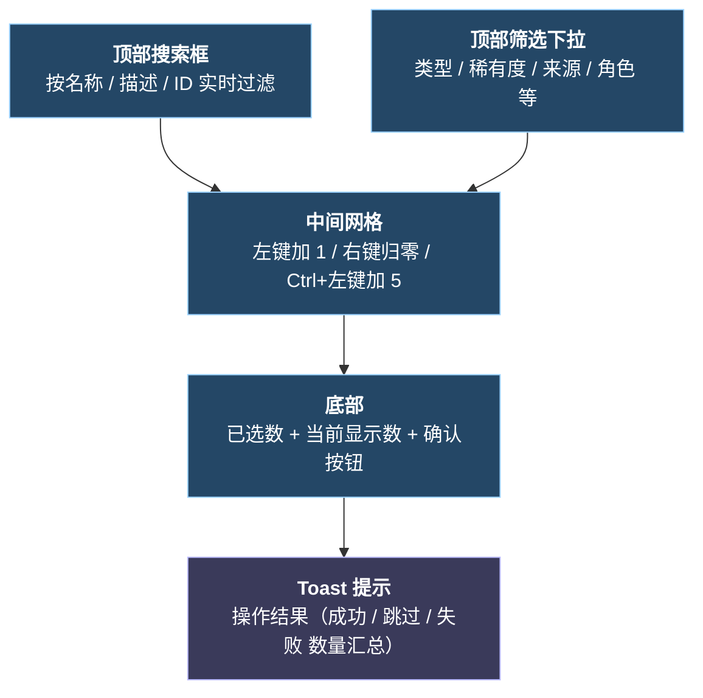
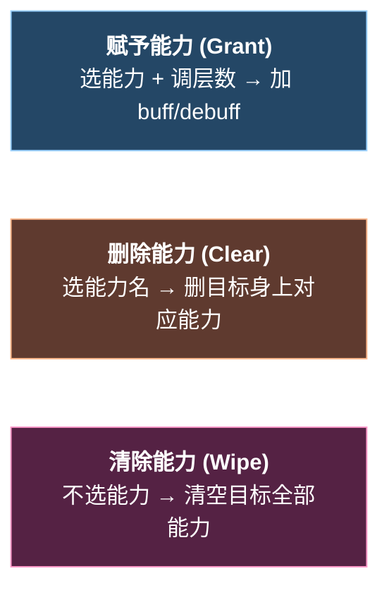

# sts2-gm 使用说明

> 这是给老大爷自己人看的操作手册。Mod 名是 **sts2-gm**（也叫"GM 控制台 / GM 管理页面"），目的是在《杀戮尖塔 2》运行时打开一块面板，发遗物 / 发药水 / 发卡 / 调能力 / 召怪 / 跳事件 / 改岁月史书。

---

## 1. 怎么打开 GM 面板

进入游戏后（主菜单或局内都行），有 **3 种方式** 等价：

| 方式 | 操作 |
|---|---|
| 顶栏按钮 | 顶栏上多出来一个 GM 图标按钮（图片素材：`图片素材/gm按钮.png`），单击切换 |
| 快捷键 H | 任何时刻按一下 `H` 键，切换打开 / 关闭 |
| 关闭：Esc | 面板**显示中**时按 `Esc`，**只关掉 GM 面板**，不会触发游戏的暂停菜单 |

> 实现位置：`@d:\code\my\2\sts2-gm\ModTemplateCode\UI\GmUiManager.cs:290`（顶栏接入）、`@d:\code\my\2\sts2-gm\ModTemplateCode\UI\GmUiManager.cs:305`（H 热键）、`@d:\code\my\2\sts2-gm\ModTemplateCode\UI\GmUiManager.cs:321`（Esc 拦截）。

---

## 2. 面板结构总览


**9 个页签**（依次出现在左侧导航）：

| 顺序 | 页签名（中 / 英） | 作用 |
|---:|---|---|
| 1 | 遗物自助 / Relic Self-Service | 一次性发放任意遗物 |
| 2 | 遗物删除 / Remove Relics | 删除已持有的遗物 |
| 3 | 药水自助 / Potion Self-Service | 发放药水 + 调整药水栏位数 |
| 4 | 卡片自助 / Grant Cards | 给牌组加卡（战斗中同时进入手牌）|
| 5 | 卡片删除 / Remove Cards | 从牌组中移除卡片 |
| 6 | 能力图鉴 / Power Catalog | 给玩家或怪物加 / 减 / 清能力（buff / debuff）|
| 7 | 刷怪笼 / Monster Cage | 在战斗中召唤指定怪物 |
| 8 | 事件任意门 / Event Portal | 触发任意事件 + 阶段 / 房间快速跳转 |
| 9 | 岁月史书 / Chronicle | 全局开关、玩家数值、倍率、地图跳转 |

---

## 3. 公共操作约定

每个网格类页签（除"岁月史书"外）都遵循同一套交互：



**鼠标操作速查**：

| 操作 | 效果 |
|---|---|
| **左键单击格子** | 选中数 +1（已选时再点继续 +1）|
| **右键单击格子** | 选中数清零 |
| **Ctrl + 左键** | 选中数 +5（用于快速囤卡 / 多层 Power）|
| **悬停在格子上** | 弹出富文本 Tooltip：图标、描述、标签着色 |
| **悬停在怪物格** | Tooltip 内额外渲染怪物的小预览动画 |

> 状态栏文案示例：`已选 12 张  当前显示 78 张  （右键清零，Ctrl+左键 +5）`，定义在 `@d:\code\my\2\sts2-gm\ModTemplateCode\UI\GmUiText.cs:547`。

---

## 4. 逐个页签详解

### 4.1 遗物自助 / 遗物删除

- **筛选**：类型 / 稀有度 / 来源
- **遗物自助**：列出所有可获取的遗物；默认允许重复发放同名遗物，若在 Mod 设置里开启“禁止重复发放遗物”，已拥有的会变灰且不可再选
- **遗物删除**：只列出"当前角色已持有"的遗物
- **限制**：`遗物自助`、`遗物删除` 都需要在游戏局内（非主菜单），否则提示 `当前不在可发放遗物的游戏局内`
- **Tooltip**：显示遗物名 + 描述 + 出处

### 4.2 药水自助

- **筛选**：稀有度 / 来源
- **附加控件（在工具栏右侧）**：**药水栏位控制**
  - `−` 按钮：减少 1 个药水栏（已放入药水比目标多时会拒绝）
  - `+` 按钮：增加 1 个药水栏
  - 中间数字框可手动输入目标栏位数
  - 实时显示 `当前已放入: N`
- **限制**：药水栏满时会跳过未发放的药水，给出 `药水栏已满，{xxx} 未发放` 提示

### 4.3 卡片自助

- **筛选**：类型（攻击 / 技能 / 能力 / 状态 / 诅咒）/ 费用（含 `3+ 费`、`X 费`）/ 角色（含"无色"）
- **额外勾选框**：
  - **多人模式卡片**：是否把多人专属卡也列进来
  - **查看升级**：勾上后所有卡显示升级版预览，不可升级的卡会标 `不可升级`
- **战斗中发牌**：自动**同时加入"牌组 + 当前手牌"**，提示文案 `{xx} 已加入牌组与手牌`
- **非战斗发牌**：只加入牌组
- **缓存机制**：卡片网格首次构建是**异步分帧**的，每帧新增几十张避免卡顿；切筛选只改 Visible，**不会重建按钮**，因此切回来很快
- **代码位置**：`@d:\code\my\2\sts2-gm\ModTemplateCode\UI\GmUiManager.Cards.cs:1`

### 4.4 卡片删除

- **筛选**：类型 / 费用（保留与卡片自助一致的入口）
- 网格只显示**当前牌组中**的卡片
- **战斗中删牌限制**（重要！）：仅修改全局牌组，**本场战斗的手牌、抽牌堆、弃牌堆、消耗堆保持不变**
  - 提示文案：`战斗中删除仅修改全局牌组，本场战斗的手牌、抽牌堆、弃牌堆与消耗堆保持不变`
  - 完整文案见 `@d:\code\my\2\sts2-gm\ModTemplateCode\UI\GmUiText.cs:624`

### 4.5 能力图鉴 / Power Catalog

3 种模式（在工具栏选择）：



- **目标选择**：玩家 / 怪物（怪物模式下可勾"全部怪物"或多选具体怪物）
- **层数操作**（`Grant` 模式）：左键 +1、Ctrl+左键 +5、右键归零，按钮上显示 `层数 +N`
- **限制**：
  - 玩家目标：必须在局内，否则 `当前不在游戏局内，无法对玩家操作能力`
  - 怪物目标：必须在战斗中，否则 `当前不在战斗中，无法对怪物操作能力`
- **Wipe 模式**：不需要点能力格子，确认按钮就会清空已选目标身上的所有能力（提示语 `清除模式无须选择能力，点击确认将清空所选目标身上的全部能力`）

### 4.6 刷怪笼

- **筛选**：品阶（普通 / 精英 / Boss / 全部）
- **限制**：必须在战斗房间，否则 `当前不在战斗房间，无法召唤怪物`
- **Tooltip**：除了基本信息，还会显示血量范围 `生命值 minHp-maxHp` 和小预览动画
- **预览自适应**：怪物贴图大小不一，预览会根据像素自动 fit；面板默认避免溢出视口

### 4.7 事件任意门

包含两块：

**A. 事件网格（下半部）**
- 搜索 + 筛选事件，左键选中后点 `前往` 触发
- 限制：必须在游戏局内

**B. 快捷跳转区（上半部）**
- **阶段跳转**：下拉选 `Act 1 / Act 2 / Act 3 / 终章` 等，点 `前往`
- **宝箱房**：下拉选不同的宝箱内容（如普通宝箱 / 精英奖励等），点 `前往`
- **进入商店**：直接跳转到商店房间
- **进入营火**：直接跳转到休息点
- 上述跳转 == 游戏自带的 `act` / `room` 控制台命令，本 mod 只是把入口可视化

### 4.8 岁月史书 / Chronicle

这是功能最杂的页签，左右两栏：

#### 左栏：开关（Toggles）

| 开关名 | 效果 |
|---|---|
| 消灭所有敌人 | 立刻 kill all + **持续效果**：每进战斗自动 kill all |
| 上帝模式 | 调用游戏自带 god mode 控制台开关 |
| 无限能量 | 当前能量瞬间拉到 999，由锁定机制持续维持 |
| 总是玩家回合 | 让所有敌人显示击晕 + 伤害归零（凑合实现） |
| 免疫所有负面效果 | 定时清理玩家身上的负面 Power |
| 始终抽到上限 | 立即补牌 + 持续检查 |
| 任意地图点可点击 | 地图上任意节点都可直接点进 |

#### 右栏：3 个分组

**① 战斗操作（Combat Actions）**
- 改变敌人意图：选目标 + 选意图，点应用
- 抽牌：输入数量，点执行
- 抽牌到上限：直接补到手牌上限

**② 玩家数值（Player Values）** — 每行配 `当前值输入框 + 锁定 + 应用` 三件套，**锁定后跨页持续生效**：

| 字段 | Key |
|---|---|
| 生命值 | `CurrentHp` |
| 最大生命值 | `MaxHp` |
| 钱袋 | `Gold` |
| 能量 | `Energy` |
| 最大能量值 | `MaxEnergy` |
| 星星 | `Stars` |
| 充能球栏位 | `OrbSlots` |
| 手牌上限 | `HandLimit` |
| 每回合抽牌 | `CardsPerTurn` |
| 进阶模式等级 | `AscensionLevel` |

**③ 倍率数值（Multipliers）** — 同样支持锁定：

| 字段 | 单位 |
|---|---|
| 敌人攻击倍率 | % |
| 玩家攻击倍率 | % |
| 奖励倍率 | 整数 |
| 商店价格倍率 | % |
| 药水效果倍率 | % |

**④ 地图跳转**：在右栏底部，下拉选当前地图上任意已显示的房间节点，点应用直接传送。

> 完整定义在 `@d:\code\my\2\sts2-gm\ModTemplateCode\Services\ChronicleService.cs:26`（枚举 `ChronicleValueKey`）。

---

## 5. 快捷键速查

| 按键 | 上下文 | 行为 |
|---|---|---|
| `H` | 任意时刻 | 切换 GM 面板显示 / 隐藏 |
| `Esc` | GM 面板已显示 | **只关闭 GM 面板**，不弹游戏菜单 |
| `Esc` | GM 面板已隐藏 | 走游戏原本逻辑（暂停菜单等）|
| 左键 | 网格格子上 | 选中数 +1 |
| 右键 | 网格格子上 | 选中数清零 |
| Ctrl + 左键 | 网格格子上 | 选中数 +5 |
| 鼠标悬停 | 任意格子 | 弹 Tooltip |

---

## 6. Toast 提示文案约定

操作结果统一通过底部 **Toast** 显示，文案套路如下：

| 类型 | 模板 | 例子 |
|---|---|---|
| 单项成功 | `{X} 发放成功` / `{X} 已加入牌组` | `烈焰甜甜圈 发放成功` |
| 单项跳过 | `{X} 已拥有，不能重复获取` / `{X} 当前未持有，跳过删除` | 开启“禁止重复发放遗物”后，已拥有遗物会跳过 |
| 单项失败 | `{X} 发放失败` / `{X} 召唤失败` | — |
| 批量汇总 | `成功 N，跳过 M，失败 K` | `卡片自助成功 5，跳过 0，失败 0` |
| 状态拒绝 | `当前不在游戏局内...` / `当前不在战斗中...` | — |

完整中英文文案集中在 `@d:\code\my\2\sts2-gm\ModTemplateCode\UI\GmUiText.cs:1`，国际化判断走 `@d:\code\my\2\sts2-gm\ModTemplateCode\Services\GmLocalizationService.cs:1`（跟随游戏当前语言）。

---

## 7. 限制 & 注意事项

> 这一节最重要，老大爷动手前请扫一眼。

1. **存档兼容性**
   - GM 操作大多走游戏自带控制台命令（`relic`、`potion`、`gold`、`heal`、`energy`、`act`、`room`、`kill` 等），尽量**不破坏存档结构**
   - 但是直接修改字段的功能（如 `MaxHp`、`OrbSlots`）会落到运行时对象上，存档保存后就生效
   - **不建议**在多人匹配房里使用，可能导致客户端数据不同步

2. **战斗中卡片删除特殊行为**
   - 仅修改全局牌组；**当前战斗里的牌**（手 / 抽 / 弃 / 消耗）不会变化，结束战斗后才会真正反映
   - 这是设计取舍，避免直接戳战斗内 PileType 列表导致状态机错乱

3. **锁定（Lock）持久性**
   - 锁定的数值在 GM 面板关掉后**仍然生效**，由后台定时器持续维持
   - 退出当前 run 进新局，锁定状态会自动失效

4. **怪物预览失败**
   - 部分怪物贴图加载机制特殊（被列入 `MonsterPreviewDisabledIds`），Tooltip 上会显示 `无预览`，**不影响召唤功能**

5. **不在局内的限制提示**
   - 大部分功能（除了"事件任意门"和部分岁月史书项）都需要先开始一局游戏
   - 主菜单下打开 GM 面板会**只能浏览**，确认按钮按下去会得到对应的"不在局内"提示

6. **能力 Wipe 模式**
   - **会一次性清空**目标身上**全部 Power**，包括玩家自身的正面 buff（比如力量、敏捷、虚弱、燃烧 等无差别清空）
   - 想保留正面 buff、只清负面，请用 `免疫所有负面效果` 开关

7. **顶栏图标**
   - 图标读取自 `图片素材/gm按钮.png`，主题为深色，与游戏顶栏融合
   - 若图标加载失败，按钮会回退为文字按钮，但功能不受影响

---

## 8. 出问题怎么排查

1. **打不开面板**
   - 确认 mod 正确放进了游戏的 `Mods` 目录
   - 看一下游戏控制台日志（搜 `sts2-gm`），初始化成功会打 `sts2-gm / GM Console initialized. GM 管理页面已初始化。`
   - 如果顶栏没有按钮，按 `H` 热键尝试

2. **某个功能没效果**
   - 大部分操作都会在游戏控制台打印中文日志，先去日志里看看
   - 服务端日志位置：`@d:\code\my\2\sts2-gm\ModTemplateCode\Services\GmLogger.cs:1`

3. **想看代码内部结构**
   - 整个 UI 由 14 份 partial class 文件组成，统一在 `@d:\code\my\2\sts2-gm\ModTemplateCode\UI` 下
   - 业务逻辑分到 7 个 Service：CardService / RelicService / PotionService / PowerService / MonsterService / EventService / ChronicleService，全在 `@d:\code\my\2\sts2-gm\ModTemplateCode\Services`
   - 拆分方案见 `@d:\code\my\2\sts2-gm\my_doc\GmUiManager拆分方案.md:1`

---

## 附：完整文件结构（核心代码）

```
ModTemplateCode/
├── MainFile.cs                      # mod 入口，[ModInitializer]
├── Config/
│   └── GmModConfig.cs              # mod 配置（保留位）
├── Models/                          # UI 与 Service 之间的数据契约
│   ├── CardDisplayInfo.cs
│   ├── RelicDisplayInfo.cs
│   ├── PotionDisplayInfo.cs
│   └── ...（共 18 个 Display/Selection/Result 模型）
├── Patches/
│   ├── ChronicleRuntimePatch.cs    # 持续生效的运行时补丁（伤害倍率 / 价格倍率 等）
│   └── TopBarPatch.cs              # Harmony 把 GM 按钮挂到游戏顶栏
├── Services/                        # 业务逻辑层
│   ├── CardService.cs
│   ├── ChronicleService.cs
│   ├── EventService.cs
│   ├── GmLocalizationService.cs    # 中文 / 英文判定
│   ├── GmLogger.cs
│   ├── MonsterService.cs
│   ├── PotionService.cs
│   ├── PowerService.cs
│   └── RelicService.cs
└── UI/                              # GM 面板（partial class，14 份）
    ├── GmUiManager.cs              # 核心：入口 / 字段 / 页签切换
    ├── GmUiManager.Layout.cs       # 布局：根容器 / 工具栏 / 底栏 / Toast
    ├── GmUiManager.Theme.cs        # 主题样式
    ├── GmUiManager.Localization.cs # 文案绑定刷新
    ├── GmUiManager.TopBar.cs       # 顶栏接入
    ├── GmUiManager.Tooltip.cs      # 悬停说明
    ├── GmUiManager.Confirm.cs      # 确认 / 清空选择
    ├── GmUiManager.Relics.cs       # 遗物
    ├── GmUiManager.Potions.cs      # 药水
    ├── GmUiManager.Cards.cs        # 卡片（含异步缓存）
    ├── GmUiManager.Powers.cs       # 能力
    ├── GmUiManager.Monsters.cs     # 怪物（含预览动画）
    ├── GmUiManager.Events.cs       # 事件 + 跳转
    ├── GmUiManager.Chronicle.cs    # 岁月史书
    └── GmUiText.cs                 # 国际化文案
```

---

**最后**：本说明根据当前代码（截至本次拆分完成时）整理。后续如果加了新页签 / 新按钮，麻烦顺手回来更新一下这份文档，不然下一次就找不着北了。
